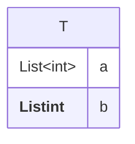

**Title:** ER diagram: markdown formatting on an attribute type that uses generics is dropped

## Description

In an `erDiagram`, markdown on an attribute type is applied, except when the type uses the `~` generic syntax. The text is shown without its bold or italic.

Expected: both types are bold. Actual: `Listint` is bold, `List<int>` is plain. The same happens with `htmlLabels: true` and `htmlLabels: false`.

The `*__List~List~int~~sdfds__*` type in `e2e/diagrams/er-diagram/visual-check/an-er-diagram-with-unicode-text-without-htmllabels-default.mmd` is affected too (mentioned in #8716).

## Cause

`erBox.ts` `addText` escapes `<`/`>` to `&lt;`/`&gt;` before `createText`, then restores them by assigning `textContent` on `text.children[0]` and each first child below it. Assigning `textContent` replaces all child nodes, so the `<strong>`/`<em>` elements (or styled `tspan`s) are removed.

Checked on `develop` at 7a027f757.
